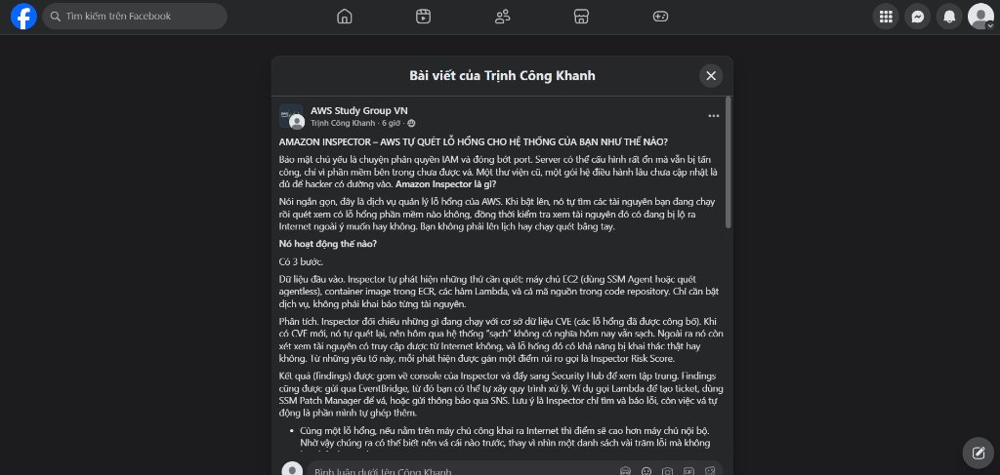
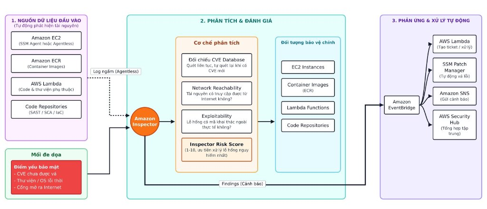

# AMAZON INSPECTOR – AWS TỰ QUÉT LỖ HỔNG CHO HỆ THỐNG CỦA BẠN NHƯ THẾ NÀO?

**Link bài đăng gốc:** [AWS Study Group VN – Facebook](https://www.facebook.com/share/p/19zsn47hkx/)

Bảo mật chủ yếu là chuyện phân quyền IAM và đóng bớt port. Server có thể cấu hình rất ổn mà vẫn bị tấn công, chỉ vì phần mềm bên trong chưa được vá. Một thư viện cũ, một gói hệ điều hành lâu chưa cập nhật là đủ để hacker có đường vào.

### 1. AMAZON INSPECTOR LÀ GÌ?

Nói ngắn gọn, đây là dịch vụ quản lý lỗ hổng của AWS. Khi bật lên, nó tự tìm các tài nguyên bạn đang chạy rồi quét xem có lỗ hổng phần mềm nào không, đồng thời kiểm tra xem tài nguyên đó có đang bị lộ ra Internet ngoài ý muốn hay không. Bạn không phải lên lịch hay chạy quét bằng tay.

### 2. NÓ HOẠT ĐỘNG THẾ NÀO?

Có 3 bước:

- **Dữ liệu đầu vào:** Inspector tự phát hiện những thứ cần quét: máy chủ EC2 (dùng SSM Agent hoặc quét agentless), container image trong ECR, các hàm Lambda, và cả mã nguồn trong code repository. Chỉ cần bật dịch vụ, không phải khai báo từng tài nguyên.
- **Phân tích:** Inspector đối chiếu những gì đang chạy với cơ sở dữ liệu CVE (các lỗ hổng đã được công bố). Khi có CVE mới, nó tự quét lại, nên hôm qua hệ thống “sạch” không có nghĩa hôm nay vẫn sạch. Ngoài ra nó còn xét xem tài nguyên có truy cập được từ Internet không, và lỗ hổng đó có khả năng bị khai thác thật hay không. Từ những yếu tố này, mỗi phát hiện được gán một điểm rủi ro gọi là **Inspector Risk Score**.
- **Kết quả (Findings) & Phản ứng:** Kết quả (findings) được gom về console của Inspector và đẩy sang Security Hub để xem tập trung. Findings cũng được gửi qua EventBridge, từ đó bạn có thể tự xây quy trình xử lý. Ví dụ gọi Lambda để tạo ticket, dùng SSM Patch Manager để vá, hoặc gửi thông báo qua SNS. Lưu ý là Inspector chỉ tìm và báo lỗi, còn việc vá tự động là phần mình tự ghép thêm.

Cùng một lỗ hổng, nếu nằm trên máy chủ công khai ra Internet thì điểm sẽ cao hơn máy chủ nội bộ. Nhờ vậy chúng ta có thể biết nên vá cái nào trước, thay vì nhìn một danh sách vài trăm lỗi mà không biết bắt đầu từ đâu.

### 3. CHI PHÍ & ĐỐI TƯỢNG PHÙ HỢP

**Chi phí:**
Inspector tính tiền theo mức sử dụng, không có phí tối thiểu hay cam kết trước. Tài khoản mới có 15 ngày dùng thử miễn phí cho từng loại quét, nên có thể bật thử để xem hệ thống của mình có bao nhiêu lỗ hổng và chi phí khoảng bao nhiêu. Riêng CIS Benchmark thì không nằm trong gói dùng thử. Giá chi tiết khác nhau theo region, bạn nên xem trên trang pricing của AWS.

**Nó phù hợp với ai?**
Hợp với các doanh nghiệp vừa và nhỏ không có đội bảo mật riêng, hoặc hệ thống chạy container, Lambda và hay cập nhật thư viện. Những trường hợp này rất khó theo dõi lỗ hổng bằng tay.

### 4. KẾT LUẬN

Giá trị của Inspector không nằm ở chuyện liệt kê lỗ hổng, vì việc đó nhiều công cụ làm được. Điểm khác là nó xếp hạng theo bối cảnh thực tế của hệ thống, nên mình biết nên xử lý cái gì trước. Kết hợp với EventBridge, cả quy trình từ phát hiện đến thông báo và xử lý có thể chạy gần như tự động.

**Tài liệu tham khảo:**
- [Amazon Inspector – Official Documentation](https://docs.aws.amazon.com/inspector/latest/user/what-is-inspector.html)
- [Amazon Inspector – Pricing](https://aws.amazon.com/inspector/pricing/)

*[#AWS](https://www.facebook.com/hashtag/AWS) [#AmazonInspector](https://www.facebook.com/hashtag/AmazonInspector) [#CloudSecurity](https://www.facebook.com/hashtag/CloudSecurity) [#FCAJ](https://www.facebook.com/hashtag/FCAJ)*
