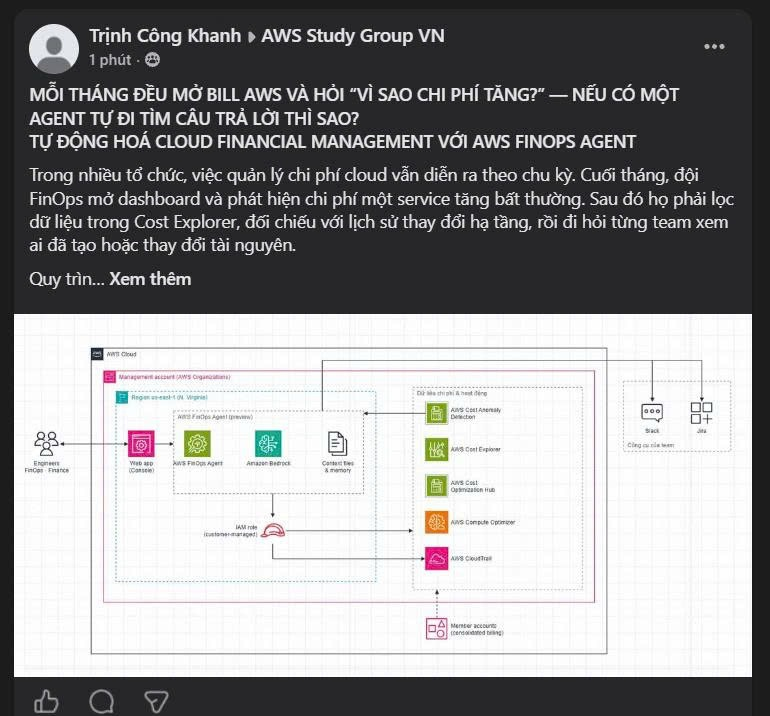
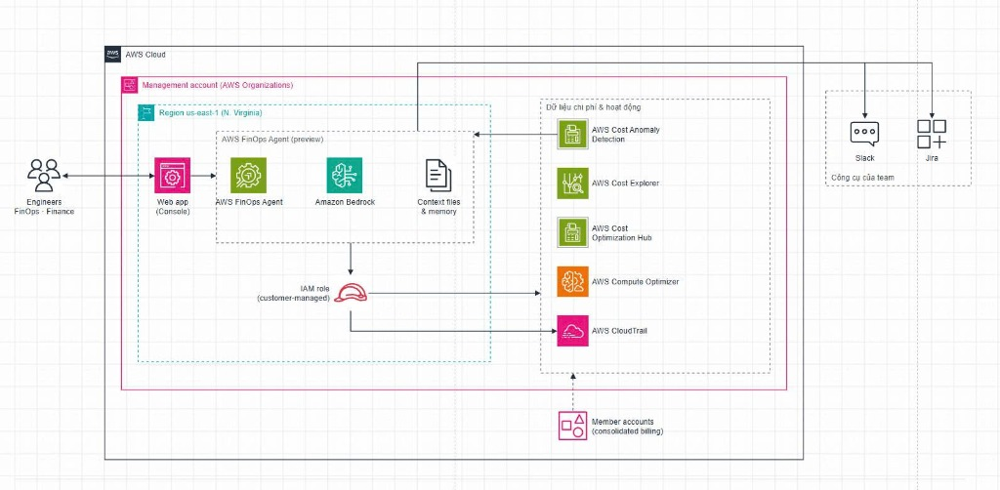

# MỖI THÁNG ĐỀU MỞ BILL AWS VÀ HỎI “VÌ SAO CHI PHÍ TĂNG?” — NẾU CÓ MỘT AGENT TỰ ĐI TÌM CÂU TRẢ LỜI THÌ SAO?
### TỰ ĐỘNG HOÁ CLOUD FINANCIAL MANAGEMENT VỚI AWS FINOPS AGENT

**Link bài đăng gốc:** [AWS Study Group VN – Facebook](https://www.facebook.com/share/p/1R7PLrnFum/)

Trong nhiều tổ chức, việc quản lý chi phí cloud vẫn diễn ra theo chu kỳ. Cuối tháng, đội FinOps mở dashboard và phát hiện chi phí một service tăng bất thường. Sau đó họ phải lọc dữ liệu trong Cost Explorer, đối chiếu với lịch sử thay đổi hạ tầng, rồi đi hỏi từng team xem ai đã tạo hoặc thay đổi tài nguyên.

Quy trình này tốn thời gian. Quan trọng hơn, nó mang tính phản ứng: khi nguyên nhân được tìm ra, chi phí đã phát sinh từ nhiều ngày trước. Từ đó đặt ra một câu hỏi: liệu việc điều tra chi phí có nhất thiết phải chờ đến kỳ review hằng tháng, hay có thể diễn ra ngay khi bất thường xuất hiện?

AWS FinOps Agent ra mắt bản public preview vào ngày 09/06/2026. Đây là một frontier agent xây dựng trên Amazon Bedrock, được thiết kế để trả lời câu hỏi về chi phí, tự động điều tra cost anomaly và chạy các workflow FinOps định kỳ. Hướng tiếp cận này giúp chuyển Cloud Financial Management từ những buổi review thủ công sang vận hành liên tục, dựa trên sự kiện.

### 1. AWS FINOPS AGENT GIẢI QUYẾT VẤN ĐỀ GÌ?

FinOps (Financial Operations) là phương pháp kết nối đội tài chính, kỹ thuật và kinh doanh. Mục tiêu là tối đa hoá giá trị của khoản đầu tư cloud thông qua trách nhiệm tài chính chung và các quyết định dựa trên dữ liệu.

Thách thức nằm ở chỗ dữ liệu chi phí và dữ liệu vận hành thường tách rời nhau. Cost Anomaly Detection có thể báo chi phí đang tăng, nhưng không trả lời thay đổi nào gây ra điều đó, ai chịu trách nhiệm và cần xử lý ra sao. Phần điều tra này vẫn phụ thuộc vào con người.

AWS FinOps Agent đảm nhận đúng phần việc đó. Engineer có thể đặt câu hỏi bằng ngôn ngữ tự nhiên, chẳng hạn “Vì sao chi phí AWS tháng trước tăng?”. Agent sẽ trả lời dựa trên dữ liệu cost và usage thực tế: chi phí thay đổi bao nhiêu, service nào đóng góp chính và yếu tố usage nào đứng sau.

### 2. KIẾN TRÚC VÀ CÁC THÀNH PHẦN CHÍNH

Agent được tạo trong AWS account, chạy tại Region US East (N. Virginia), và người dùng tương tác qua một web application dạng chat.

Amazon Bedrock cung cấp foundation model cho khả năng suy luận và lập kế hoạch điều tra.

Ở phía dữ liệu, agent kết hợp nhiều dịch vụ AWS sẵn có:

- **AWS Cost Explorer:** dữ liệu cost và usage.
- **AWS Cost Anomaly Detection:** phát sự kiện khi có bất thường.
- **AWS Cost Optimization Hub và AWS Compute Optimizer:** khuyến nghị rightsizing, tài nguyên idle và Savings Plans.
- **AWS CloudTrail:** bản ghi ai thay đổi gì, vào lúc nào.

Điểm đáng chú ý là agent không tạo ra một nguồn dữ liệu chi phí mới. Nó đứng phía trên các dịch vụ quản lý chi phí mà tổ chức đã sử dụng và liên kết chúng lại thành một luồng điều tra thống nhất.

Ngoài ra, có thể upload context files như mapping giữa account và owner, định nghĩa team, quy ước tagging hay tần suất review. Agent sẽ áp dụng các thông tin này vào câu trả lời và ghi nhớ ngữ cảnh qua các phiên làm việc.

Kết quả được gửi đến các công cụ mà engineer đã quen dùng: đăng báo cáo lên Slack hoặc mở ticket trên Jira.

### 3. CƠ CHẾ ĐIỀU TRA COST ANOMALY HOẠT ĐỘNG NHƯ THẾ NÀO?

Agent có thể được cấu hình để lắng nghe sự kiện từ Cost Anomaly Detection.

Khi một cảnh báo xuất hiện, agent đối chiếu biến động chi phí với các sự kiện trong CloudTrail. Từ đó nó xác định thay đổi nào dẫn đến mức tăng đột biến, rồi tổng hợp thành một bản báo cáo điều tra gồm nguyên nhân có khả năng xảy ra và người chịu trách nhiệm liên quan.

Bản báo cáo được gửi tới Slack channel hoặc tạo thành Jira ticket. Nhờ vậy, đội kỹ thuật nhận được thông tin mà không cần một bước triage thủ công.

Bên cạnh mô hình event-driven, agent còn có thể chạy workflow theo lịch do người dùng định nghĩa, ví dụ báo cáo chi phí định kỳ cho đội tài chính và đội kỹ thuật.

### 4. KIỂM SOÁT QUYỀN TRUY CẬP VÀ BẢO MẬT

Khi một AI agent được phép đọc dữ liệu tài chính và dữ liệu vận hành, câu hỏi về quyền truy cập trở nên đặc biệt quan trọng.

Agent truy cập dữ liệu thông qua customer-managed IAM role. Tổ chức có thể giới hạn account, service và action mà agent được phép sử dụng, theo đúng nguyên tắc least privilege.

AWS cũng mô tả các cơ chế blast-radius control và rollback. Người dùng có thể thiết lập giới hạn theo các chiều như account, Region hoặc mức tác động tài chính tối đa.

Toàn bộ hoạt động của agent được AWS CloudTrail ghi nhận trong account đang host agent. Điều này tạo ra audit trail để kiểm tra lại agent đã truy cập những gì và vào thời điểm nào.

### 5. CÁC BƯỚC BẮT ĐẦU

Theo hướng dẫn của AWS, quy trình khởi tạo gồm năm bước:

1. Đăng nhập AWS Management Console, chuyển sang Region `us-east-1` và mở trang AWS FinOps Agent để tạo agent đầu tiên.
2. Cấu hình IAM role bằng một lần nhấp. Role này là customer-managed role mà agent dùng để đọc dữ liệu chi phí, usage và vận hành.
3. Kết nối Jira và Slack (tuỳ chọn).
4. Kiểm tra lại cấu hình agent.
5. Mở web application để bắt đầu làm việc với agent.

### 6. NHỮNG GIỚI HẠN CẦN CÂN NHẮC

Mặc dù AWS FinOps Agent giúp giảm đáng kể khối lượng điều tra thủ công, đây vẫn là dịch vụ ở giai đoạn preview. Tính năng và phạm vi có thể thay đổi trước khi chính thức GA.

Trong thời gian preview, agent chỉ có tại US East (N. Virginia). Dữ liệu chi phí bao phủ mọi Region ngoại trừ AWS GovCloud (US) và các Region tại Trung Quốc. Dịch vụ miễn phí trong giai đoạn này nhưng có giới hạn usage hằng tháng và service quota. Mức giá khi GA hiện chưa được công bố, vì vậy chưa thể đánh giá đầy đủ tổng chi phí sở hữu.

Agent chỉ làm việc với dữ liệu AWS. Những tổ chức sử dụng multi-cloud vẫn cần thêm công cụ khác để có bức tranh chi phí tổng thể.

Chất lượng câu trả lời cũng phụ thuộc vào chất lượng dữ liệu đầu vào. Nếu tagging không nhất quán hoặc mapping owner không được cập nhật, agent khó xác định chính xác người chịu trách nhiệm.

Cuối cùng, agent không thay thế đội FinOps. Kết luận về root cause vẫn cần được con người xác minh trước khi đưa ra quyết định thay đổi hạ tầng hoặc cam kết mua Savings Plans.

### KẾT LUẬN

Có dashboard chi phí chưa chắc đã có khả năng kiểm soát chi phí. Điều quan trọng là thông tin bất thường phải đến đúng người, đúng lúc, kèm theo nguyên nhân đủ rõ ràng để hành động.

AWS FinOps Agent là một hướng tiếp cận đáng cân nhắc cho các tổ chức có nhiều account, nhiều team và thường xuyên mất thời gian điều tra biến động chi phí.

Tuy nhiên, hiệu quả thực tế phụ thuộc vào cách cấu hình quyền truy cập, chất lượng tagging và context của tổ chức, cũng như mức giá khi dịch vụ chính thức ra mắt.

Tối ưu chi phí cloud không chỉ là cắt giảm tài nguyên. Đó còn là rút ngắn khoảng cách giữa thời điểm chi phí bất thường xuất hiện và thời điểm đội ngũ thực sự hiểu được nguyên nhân.

**Nguồn tham khảo:**
- [AWS What’s New – AWS FinOps Agent preview](https://aws.amazon.com/new/)
- [AWS Blog – Announcing the public preview of AWS FinOps Agent](https://aws.amazon.com/blogs/aws-cloud-financial-management/)
- [AWS FinOps Agent FAQs](https://aws.amazon.com/aws-cost-management/)
- [AWS Blog – Automation and Trust in FinOps](https://aws.amazon.com/blogs/aws-cloud-financial-management/)
- [InfoQ – AWS Previews FinOps Agent](https://www.infoq.com/)

*[#AWS](https://www.facebook.com/hashtag/AWS) [#AWSFinOpsAgent](https://www.facebook.com/hashtag/AWSFinOpsAgent) [#FinOps](https://www.facebook.com/hashtag/FinOps) [#AmazonBedrock](https://www.facebook.com/hashtag/AmazonBedrock) [#CloudFinancialManagement](https://www.facebook.com/hashtag/CloudFinancialManagement) [#AWSStudyGroup](https://www.facebook.com/hashtag/AWSStudyGroup)*
