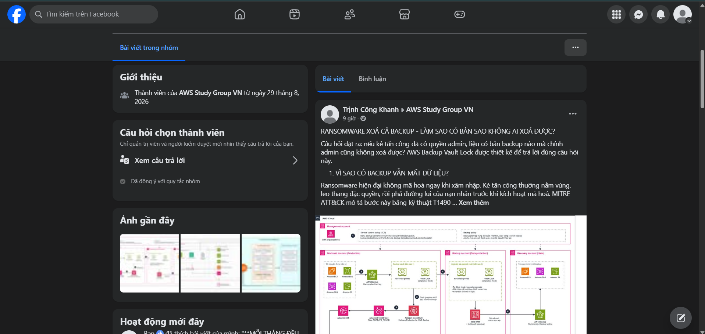
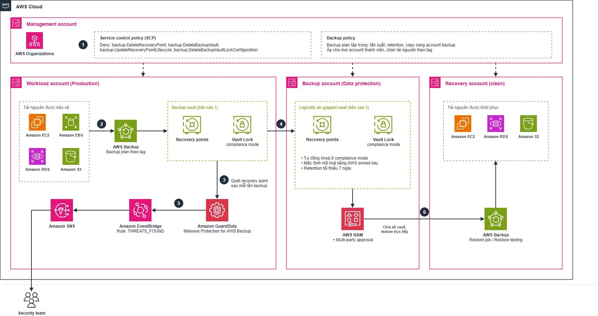

# RANSOMWARE XOÁ CẢ BACKUP - LÀM SAO CÓ BẢN SAO KHÔNG AI XOÁ ĐƯỢC?



**Link bài đăng gốc:** [AWS Study Group VN – Facebook](https://www.facebook.com/share/p/18z4csKQ1Z/)

Câu hỏi đặt ra: nếu kẻ tấn công đã có quyền admin, liệu có bản backup nào mà chính admin cũng không xoá được? AWS Backup Vault Lock được thiết kế để trả lời đúng câu hỏi này.

### 1. VÌ SAO CÓ BACKUP VẪN MẤT DỮ LIỆU?

Ransomware hiện đại không mã hoá ngay khi xâm nhập. Kẻ tấn công thường nằm vùng, leo thang đặc quyền, rồi phá đường lui của nạn nhân trước khi kích hoạt mã hoá. MITRE ATT&CK mô tả bước này bằng kỹ thuật T1490 (Inhibit System Recovery), đi kèm T1485 (Data Destruction) và T1486 (Data Encrypted for Impact).

Trên cloud, kịch bản này đơn giản hơn nhiều người nghĩ. Nếu backup nằm chung account với workload, một access key có quyền admin là đủ để xoá snapshot, xoá recovery point và xoá luôn backup vault chỉ bằng vài lệnh API.

Vấn đề cốt lõi nằm ở chỗ quyền xoá backup và quyền quản trị hệ thống thuộc về cùng một danh tính. Khi danh tính đó bị chiếm, cả dữ liệu gốc lẫn bản sao đều mất cùng lúc. Một chiến lược backup chống ransomware vì vậy phải đáp ứng ba yêu cầu: bản sao không thể bị xoá hay sửa (immutable), nằm tách biệt khỏi môi trường production (isolated), và đã được kiểm tra là sạch trước khi restore (verified).

### 2. KIẾN TRÚC VÀ CÁC THÀNH PHẦN CHÍNH

Kiến trúc gồm ba account nằm trong cùng một AWS Organization: account workload chạy production, account backup do đội data protection quản lý, và account recovery chỉ dùng khi có sự cố. Sơ đồ kiến trúc dưới đây đánh số sáu bước của luồng này.



Mỗi dịch vụ giữ một vai trò riêng:

- **AWS Organizations:** áp service control policy (SCP) và backup policy từ management account xuống mọi account thành viên.
- **AWS Backup:** chạy backup plan theo tag, tạo recovery point cho Amazon EC2, Amazon EBS, Amazon RDS và Amazon S3.
- **Backup vault có Vault Lock:** nơi chứa bản sao thứ nhất ngay trong account workload, không ai xoá được trước khi hết thời gian lưu giữ.
- **Logically air-gapped vault:** bản sao thứ hai nằm ở account backup, tự động khoá ở compliance mode và mặc định mã hoá bằng AWS owned key.
- **Amazon GuardDuty Malware Protection for AWS Backup:** quét recovery point sau mỗi lần backup để tìm malware.
- **Amazon EventBridge và Amazon SNS:** chuyển kết quả quét thành cảnh báo cho đội bảo mật.
- **AWS Resource Access Manager (RAM) và Multi-party approval:** chia sẻ vault sang account recovery khi cần restore.

Điểm đáng chú ý là kiến trúc này không dựa vào một lớp bảo vệ duy nhất. Vault Lock chống xoá, account riêng chống lan quyền, SCP chặn hành vi phá hoại ở cấp tổ chức, còn GuardDuty trả lời câu hỏi bản backup nào còn sạch. Mỗi lớp là một ranh giới độc lập, nên kẻ tấn công vượt qua lớp này vẫn bị chặn ở lớp khác.

### 3. VAULT LOCK HOẠT ĐỘNG NHƯ THẾ NÀO?

AWS Backup Vault Lock áp mô hình WORM (write once, read many) lên một backup vault. Khi vault đã khoá, AWS Backup từ chối mọi yêu cầu xoá recovery point hoặc thay đổi lifecycle của nó, kể cả khi yêu cầu đến từ root user.

Vault Lock có hai chế độ. Ở governance mode, người có đủ quyền IAM vẫn gỡ được khoá, nên chế độ này phù hợp để thử nghiệm và chống xoá nhầm. Ở compliance mode, sau khi hết thời gian chờ thì không ai thay đổi hay gỡ được khoá, kể cả chủ account và chính AWS.

Thời gian chờ đó gọi là grace time, tối thiểu 3 ngày (72 giờ). Trong khoảng này, khoá vẫn có thể được chỉnh sửa hoặc xoá. Đây là cơ hội cuối cùng để phát hiện cấu hình sai, vì sau mốc này mọi thứ trở nên bất biến.

Vault Lock còn cho phép đặt thời gian lưu giữ tối thiểu và tối đa. Backup job hoặc copy job có retention nằm ngoài khoảng này sẽ thất bại. Nhờ vậy, kẻ tấn công không thể lách bằng cách tạo backup chỉ sống một ngày rồi chờ nó tự hết hạn.

Ví dụ sau tạo khoá compliance mode với grace time 3 ngày và retention từ 7 đến 35 ngày:

```bash
aws backup put-backup-vault-lock-configuration \
  --backup-vault-name prod-vault \
  --changeable-for-days 3 \
  --min-retention-days 7 \
  --max-retention-days 35
```

Nếu bỏ tham số `--changeable-for-days`, khoá được tạo ở governance mode.

### 4. CÔ LẬP BACKUP VÀ PHÁT HIỆN MALWARE TRƯỚC KHI RESTORE

Bất biến mới chỉ là một nửa câu trả lời. Nếu bản sao duy nhất vẫn nằm trong account đã bị chiếm, kẻ tấn công không xoá được nhưng vẫn có thể cản trở việc khôi phục.

Vì vậy recovery point được copy sang logically air-gapped vault ở account backup. Loại vault này tự động khoá bằng Vault Lock ở compliance mode, mặc định mã hoá bằng AWS owned key và yêu cầu retention tối thiểu 7 ngày. Vault có thể được chia sẻ qua AWS RAM để account khác restore trực tiếp, không cần copy ngược lại.

Ở cấp tổ chức, SCP chặn các action nguy hiểm như `backup:DeleteRecoveryPoint`, `backup:DeleteBackupVault` và `backup:UpdateRecoveryPointLifecycle`. SCP áp lên cả admin của account thành viên, nên credential bị đánh cắp ở production không đủ để phá backup.

Câu hỏi còn lại là bản backup nào còn sạch. Ransomware có thể nằm vùng nhiều tuần, nên bản backup gần nhất chưa chắc dùng được. Amazon GuardDuty Malware Protection for AWS Backup, ra mắt ngày 19/11/2025, quét recovery point của Amazon EC2, Amazon EBS và Amazon S3 sau mỗi lần backup. Kết quả trả về là `NO_THREATS_FOUND` hoặc `THREATS_FOUND`, đồng thời được phát thành sự kiện trên Amazon EventBridge để gửi cảnh báo qua Amazon SNS.

Khi cần khôi phục, đội vận hành chọn recovery point sạch gần nhất và restore vào account recovery. Từ ngày 17/06/2025, logically air-gapped vault còn hỗ trợ Multi-party approval: một nhóm người được tin cậy phải cùng phê duyệt trước khi vault được chia sẻ, kể cả khi account sở hữu vault không còn truy cập được.

### 5. CÁC BƯỚC BẮT ĐẦU

Có thể triển khai kiến trúc này theo sáu bước:

1. Tạo một account backup riêng trong AWS Organizations và bật tính năng cross-account backup từ management account.
2. Tạo backup vault ở account workload và bật Vault Lock. Nên thử ở governance mode trước, sau đó mới tạo khoá compliance mode.
3. Tạo logically air-gapped vault ở account backup, rồi thêm vault này làm copy destination trong backup plan.
4. Gắn SCP chặn các action xoá và sửa backup lên các account thành viên.
5. Bật malware scanning trong backup plan, tạo EventBridge rule cho kết quả `THREATS_FOUND` và gửi về SNS topic của đội bảo mật.
6. Chia sẻ vault với account recovery qua AWS RAM và chạy restore testing định kỳ.

### 6. NHỮNG GIỚI HẠN CẦN CÂN NHẮC

- **Compliance mode không thể hoàn tác.** Nếu đặt retention quá dài, tổ chức phải trả phí lưu trữ cho đến hết thời hạn. Recovery point có retention “Always” sẽ bị giữ vĩnh viễn sau khi grace time kết thúc.
- **Vault Lock chỉ kiểm soát thao tác đi qua AWS Backup.** Theo tài liệu AWS, các EC2 API gọi trực tiếp như `ec2:ModifySnapshotAttribute` vẫn có thể chia sẻ snapshot ra ngoài, còn `ec2:DisableImage` có thể chặn việc restore. Các action này cần được chặn thêm bằng IAM policy hoặc SCP.
- **Khoá không bảo vệ được một account bị đóng.** Nếu account không được mở lại trong 90 ngày, AWS xoá nội dung vault kể cả khi đang có Vault Lock.
- **Bất biến không đồng nghĩa với sạch.** GuardDuty chỉ báo kết quả quét, không tự xoá hay chặn recovery point nhiễm malware, và việc quét được tính phí theo GuardDuty. Incremental scan chưa hỗ trợ recovery point của EC2 nằm trong logically air-gapped vault.
- **Không chống được việc đánh cắp dữ liệu.** Với kiểu tống tiền kép, kẻ tấn công doạ công bố dữ liệu thay vì chỉ mã hoá, và backup không giải quyết được rủi ro đó.
- **Chi phí và phạm vi hỗ trợ.** Lưu hai bản sao làm tăng chi phí lưu trữ, và logically air-gapped vault chưa hỗ trợ mọi loại tài nguyên hay mọi Region. Một bản backup chưa từng được restore thử thì chưa thể coi là đáng tin.

### 7. KẾT LUẬN

Có backup chưa chắc đã có khả năng khôi phục. Điều quan trọng là bản sao phải tồn tại ngoài tầm với của chính những danh tính có thể bị chiếm.

AWS Backup Vault Lock, kết hợp với logically air-gapped vault, SCP và GuardDuty Malware Protection, là hướng tiếp cận đáng cân nhắc cho các tổ chức chạy workload quan trọng trên AWS, đặc biệt trong tài chính, chứng khoán và thương mại điện tử.

Tuy nhiên, hiệu quả thực tế phụ thuộc vào cách tách account, cách thiết kế retention và việc diễn tập restore thường xuyên.

Chống ransomware không chỉ là ngăn kẻ tấn công xâm nhập. Đó còn là bảo đảm rằng khi mọi lớp phòng thủ khác thất bại, tổ chức vẫn còn một bản sao sạch để quay về.

**Tài liệu tham khảo:**
- [AWS Backup Developer Guide – AWS Backup Vault Lock](https://docs.aws.amazon.com/aws-backup/latest/devguide/vault-lock.html)
- [AWS Backup Developer Guide – Logically air-gapped vault](https://docs.aws.amazon.com/aws-backup/latest/devguide/logicallyairgappedvault.html)
- [AWS Storage Blog – Securing backup data against modern threats with AWS Backup](https://aws.amazon.com/blogs/storage/securing-backup-data-against-modern-threats-with-aws-backup/)
