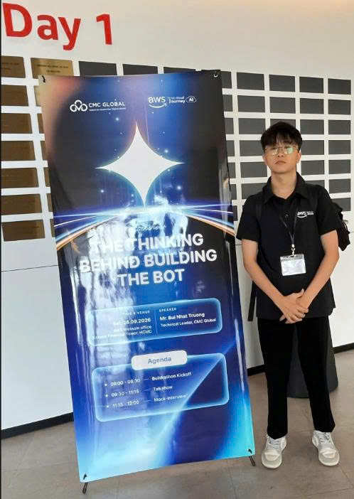

# Bài thu hoạch “The Thinking Behind Building The Bot”

Buổi Talkshow do **CMC Global** phối hợp cùng **AWS First Cloud Journey** tổ chức tại văn phòng Amazon Web Services Việt Nam, tập trung vào tư duy thiết kế và phát triển AI Agent thực chiến trong môi trường doanh nghiệp.

* **Tên sự kiện:** The Thinking Behind Building The Bot
* **Thời gian:** 26/09/2026
* **Địa điểm:** Bitexco Tower - TP. Hồ Chí Minh
* **Vai trò tham gia:** Student
* **Nội dung chính tiếp thu:** Tư duy AI Agent thực chiến

### Những Gì Học Được

#### Mài giũa tư duy AI & Cloud chuẩn Doanh nghiệp

**Tham gia các sân chơi thực chiến và cộng đồng công nghệ giúp mài giũa tư duy giải quyết bài toán AI & Cloud chuẩn doanh nghiệp.**

- Hiểu rõ tư duy thiết kế AI Agent thực tế: không dừng lại ở prompt mà là quản trị Context Window, tối ưu token, giảm độ trễ và bảo mật dữ liệu khách hàng.
- Áp dụng kiến trúc RAG (Retrieval-Augmented Generation) kết hợp Vector Database để xây dựng các giải pháp trả lời thông minh trên nền tảng AWS Cloud.

#### Kết nối chuyên gia & Tăng tốc sự nghiệp

**Chủ động kết nối trực tiếp với chuyên gia và nhà tuyển dụng mở ra cơ hội fast-track tăng tốc sự nghiệp.**

- Tham gia phỏng vấn thử (Mock Interview) trực tiếp cùng Technical Leader từ CMC Global, tiếp thu phản hồi thực tế về kỹ năng giải quyết vấn đề và phương pháp STAR.
- Mở rộng mạng lưới quan hệ với các kỹ sư đầu ngành, định hướng rõ ràng lộ trình phát triển trong lĩnh vực Cloud Security & AI Engineering.

#### Một số hình ảnh khi tham gia sự kiện

*Ảnh xác nhận tham gia sự kiện — Bitexco Tower*

> "Tham gia các sân chơi thực chiến và cộng đồng công nghệ giúp mài giũa tư duy giải quyết bài toán AI & Cloud chuẩn doanh nghiệp. Chủ động kết nối trực tiếp với chuyên gia và nhà tuyển dụng mở ra cơ hội fast-track tăng tốc sự nghiệp."
