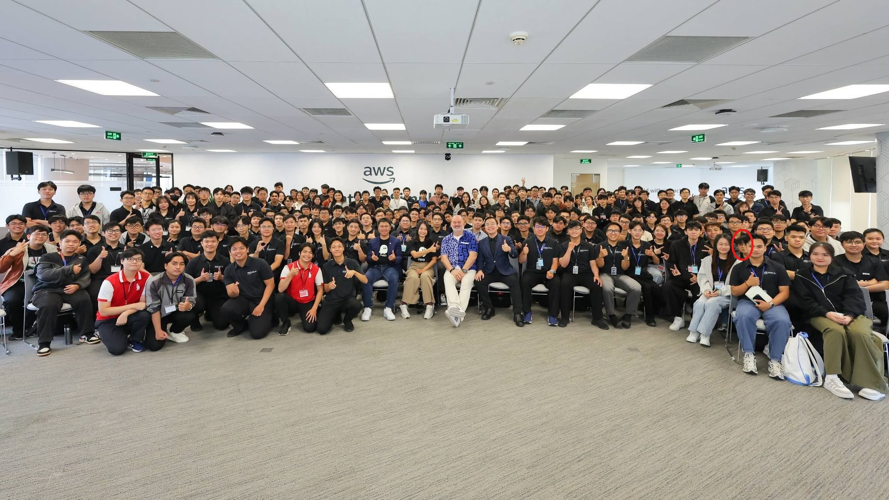

# Bài thu hoạch “Navigating the Future of Cloud & AI in Vietnam”

Sự kiện có phần keynote của Werner Vogels, CTO của Amazon, về những bài học vận hành hệ thống lớn và vai trò của lập trình viên trong kỷ nguyên AI.

### Thông Tin Sự Kiện

* **Tên sự kiện:** Navigating the Future of Cloud & AI in Vietnam
* **Thời gian:** 02/10/2026, 09:00 – 12:00
* **Địa điểm:** Bitexco Financial Tower, TP. Hồ Chí Minh
* **Vai trò tham gia:** Người tham dự
* **Nội dung cốt lõi:** Bài học vận hành hệ thống lớn và chân dung “Renaissance Developer”

### Mục Đích Của Sự Kiện

- Chia sẻ lý do Amazon phải tự xây dựng công nghệ lõi khi giải pháp có sẵn không còn đáp ứng được quy mô
- Trình bày các nguyên tắc vận hành hệ thống lớn một cách ổn định
- Trả lời câu hỏi lập trình viên có bị thay thế khi AI tự động hóa việc viết code
- Định hướng những phẩm chất cần rèn luyện để không bị tụt lại

### Danh Sách Diễn Giả

- **Werner Vogels** - CTO, Amazon

### Nội Dung Nổi Bật

#### Từ sự cố hàng triệu USD đến công nghệ lõi tự xây dựng

- Khi Werner Vogels rời Đại học Cornell để gia nhập Amazon hơn hai thập kỷ trước, không phần mềm có sẵn nào đáp ứng được quy mô của công ty
- Vào một ngày 12/12 cao điểm mua sắm, cụm cơ sở dữ liệu quan hệ bị quá tải và một lỗi tiềm ẩn làm gián đoạn việc lưu trữ dữ liệu khách hàng trong một ngày, gây thiệt hại hàng triệu USD
- Nhà cung cấp cho rằng Amazon đã dùng sản phẩm vượt giới hạn thiết kế

Amazon phân tích lại cách cơ sở dữ liệu được sử dụng:

| Loại truy vấn | Tỷ lệ | Đặc điểm |
|---|---|---|
| **Key-value** | Khoảng 70% | Tra cứu đơn giản, ví dụ lấy giỏ hàng theo ID |
| **Bảng đơn** | Khoảng 20% | Làm việc trên một bảng, không liên kết |
| **Quan hệ** | Khoảng 10% | Thật sự cần tính năng của cơ sở dữ liệu quan hệ |

Từ kết quả này, Amazon tự xây dựng hệ thống lưu trữ key-value phân tán, là nền tảng của Dynamo và DynamoDB.

#### Bốn trụ cột của vận hành xuất sắc

| Trụ cột | Ý nghĩa |
|---|---|
| **Đo ở mức P99.9** | Độ trễ trung vị che khuất trải nghiệm của một nửa người dùng có kết quả kém hơn, nên cần nhìn vào nhóm chậm nhất |
| **Everything Fails All the Time** | Kiến trúc phải chịu được việc mất đột ngột một hoặc hai data center mà dịch vụ không gián đoạn |
| **GameDays** | Chủ động ngắt data center production để diễn tập, loại bỏ thao tác thủ công và tự động đồng bộ dữ liệu khi khôi phục |
| **Đảo ngược mô hình kinh tế IT** | Pay-as-you-go thay cho hợp đồng dài hạn trả trước, buộc nhà cung cấp phải phục vụ tốt mỗi ngày để giữ khách hàng |

#### Chân dung “Renaissance Developer”

Lập trình viên vẫn giữ được giá trị nếu chịu thay đổi. Diễn giả nêu năm phẩm chất:

- **Tò mò và học hỏi liên tục**: không ngừng tìm hiểu công nghệ mới
- **Tư duy hệ thống**: hiểu cách các microservice tương tác ở quy mô lớn, không chỉ một module riêng lẻ
- **Tinh thần làm chủ**: AI có thể sinh code, nhưng kỹ sư vẫn chịu trách nhiệm về lỗi production, bảo mật và kiến trúc
- **Chuyên môn hình chữ T**: giỏi sâu một lĩnh vực và hiểu rộng các lĩnh vực liền kề như giao diện, nghiệp vụ và cơ sở dữ liệu
- **Giao tiếp**: tìm ra vấn đề thật sau những yêu cầu chạy theo trào lưu và giải thích được sự đánh đổi, ví dụ chênh lệch chi phí giữa uptime 99,99% và 99%

#### AI là chất xúc tác, con người là cốt lõi

- AI rút ngắn thời gian làm prototype từ vài tuần xuống vài giờ
- AI được ví như một trình biên dịch ngôn ngữ tự nhiên chưa chính xác tuyệt đối, nên kết quả cần con người kiểm tra về bảo mật, trường hợp biên và hiệu năng
- AI làm tốt việc lặp lại, còn khả năng phán đoán, sáng tạo, đồng cảm và niềm tự hào nghề nghiệp vẫn thuộc về con người

#### Câu nói được trích dẫn

> “We've always done it this way” (Chúng ta vẫn luôn làm như vậy) là câu nói nguy hiểm nhất, theo lời cảnh báo của Grace Hopper được diễn giả nhắc lại.

### Những Gì Học Được

#### Tư Duy Kiến Trúc

- Phân tích cách dữ liệu thật sự được truy cập trước khi chọn cơ sở dữ liệu
- Ở quy mô rất lớn, phụ thuộc vào giải pháp có sẵn có thể trở thành rủi ro vận hành

#### Tư Duy Vận Hành

- Thiết kế với giả định rằng mọi thành phần đều có thể hỏng
- Khả năng khôi phục chỉ đáng tin khi đã được diễn tập
- Số trung bình và trung vị không đủ để đánh giá trải nghiệm người dùng

#### Tư Duy Nghề Nghiệp

- Dùng AI để làm nhanh hơn nhưng vẫn chịu trách nhiệm về kết quả
- Rèn cả chiều sâu chuyên môn lẫn kỹ năng giao tiếp

### Ứng Dụng Vào Công Việc

- **Chọn cơ sở dữ liệu theo kiểu truy vấn**, ưu tiên DynamoDB cho các tra cứu key-value
- **Theo dõi độ trễ theo percentile** trên CloudWatch thay vì chỉ nhìn giá trị trung bình
- **Thiết kế cho tình huống lỗi** với retry, Dead Letter Queue và cảnh báo
- **Diễn tập sự cố ở quy mô nhỏ** trong môi trường lab
- **Kiểm tra kỹ code do AI sinh ra**, đặc biệt về bảo mật và trường hợp biên

### Trải nghiệm trong event

Tham gia **Navigating the Future of Cloud & AI in Vietnam** giúp tôi nhìn rõ hơn những gì nằm sau một hệ thống vận hành ở quy mô lớn và vai trò của kỹ sư khi có AI hỗ trợ.

#### Học hỏi từ diễn giả
- Câu chuyện về sự cố cơ sở dữ liệu cho tôi thấy một quyết định kiến trúc tốt bắt đầu từ việc hiểu dữ liệu của chính mình.
- Năm phẩm chất của “Renaissance Developer” cho tôi một khung rõ ràng để tự đánh giá.

#### Góc nhìn về AI
- Tôi hiểu rằng AI thay đổi cách làm việc, nhưng trách nhiệm về bảo mật và chất lượng vẫn thuộc về kỹ sư. Điều này gần với ngành An toàn Thông tin mà tôi đang theo học.

#### Bài học rút ra
- Hệ thống đáng tin cậy được xây dựng từ việc chấp nhận rằng lỗi sẽ xảy ra.
- Học liên tục và tư duy hệ thống quan trọng hơn việc chỉ biết dùng một công cụ.
- Không nên giữ một cách làm chỉ vì trước giờ vẫn làm như vậy.

**Nguồn tham khảo:** [The Invariable Lessons of Tech and Humanity: Key Takeaways from Amazon CTO Werner Vogels – Le Vu Xuan An, AWS Builder Center](https://builder.aws.com/content/3KBSLeKsdkk6uMUPq7d9Xxa5jbS/the-invariable-lessons-of-tech-and-humanity-key-takeaways-from-amazon-cto-werner-vogels)

#### Một số hình ảnh khi tham gia sự kiện

*Ảnh xác nhận tham gia sự kiện — Hội thảo Cộng đồng*

> Tổng thể, sự kiện giúp tôi hiểu rằng công nghệ thay đổi rất nhanh, nhưng tư duy hệ thống, tinh thần trách nhiệm và việc học liên tục vẫn là nền tảng của một kỹ sư.
