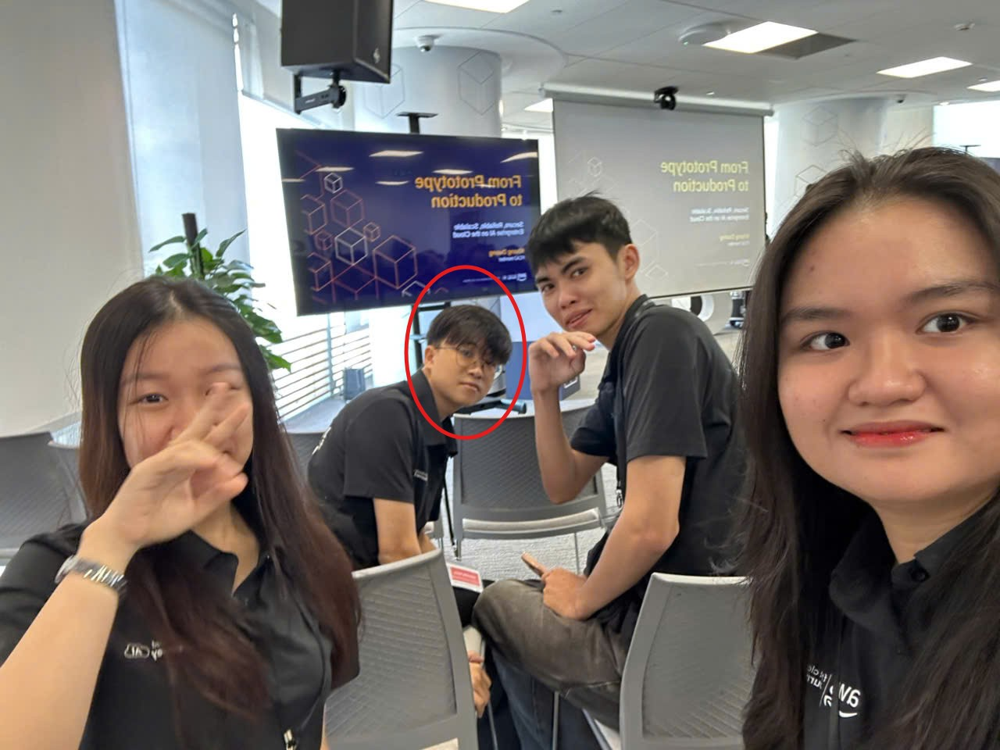

# Bài thu hoạch “Từ AI Prototype đến Production: Triển khai và Vận hành AI Doanh nghiệp trên AWS Cloud”

Workshop về các thách thức kỹ thuật khi đưa một AI prototype trở thành hệ thống doanh nghiệp đạt chuẩn production trên AWS Cloud.

### Thông Tin Sự Kiện

* **Tên sự kiện:** Enterprise AI on AWS Cloud: From Prototype to Production
* **Thời gian:** 14/11/2026, 09:00 – 12:00
* **Địa điểm:** Tầng 26, Bitexco Financial Tower, TP. Hồ Chí Minh
* **Vai trò tham gia:** Người tham dự
* **Nội dung cốt lõi:** Kiến trúc AI production: 4 trụ cột vận hành và các mô hình Multi-Agent
* **Chương trình:** FPT University Workshop, do First Cloud AI Journey (FCAJ) tổ chức
* **Hình thức:** Workshop gồm ba session: đưa AI từ prototype lên production, case study, và AI trong doanh nghiệp với Amazon Bedrock AgentCore

### Mục Đích Của Sự Kiện

- Giải thích khoảng cách giữa một prototype AI trong học thuật và một hệ thống enterprise AI
- Trình bày bốn trụ cột của AI production (bảo mật, khả năng mở rộng, độ tin cậy và chi phí) và cách cloud hỗ trợ chúng
- Học từ các case study thực tế: Cox Automotive, Mobileye và Duolingo
- Giới thiệu Amazon Bedrock AgentCore như nền tảng để vận hành agent trong doanh nghiệp

### Danh Sách Diễn Giả

- **Khang Duong** - FCAJ member
- **Phuong Huyen** - AI Engineer Fresher, FPT Software
- **Nguyen Lam Anh** - AI Engineer, FCAJ

### Nội Dung Nổi Bật

#### Session 1: From Prototype to Production – Secure, Reliable, Scalable Enterprise AI on the Cloud

**Một nhà hàng, một câu chuyện**

Diễn giả dùng phép ví von nhà hàng xuyên suốt buổi chia sẻ:

- **Prototype** = bếp nhà
- **Enterprise AI** = chuỗi nhà hàng
- **Cloud** = bếp trung tâm

**AI trong doanh nghiệp**

- Luồng xử lý là Data (nguyên liệu) → AI model (đầu bếp) → Feature (món ăn) → Users (khách hàng)
- AI thường là một tính năng bên trong sản phẩm, ví dụ gợi ý sản phẩm, chatbot hỗ trợ hoặc phát hiện gian lận

**AI học thuật và enterprise AI**

| Khía cạnh | Academic AI (bếp nhà) | Enterprise AI (chuỗi nhà hàng) |
|---|---|---|
| Mục tiêu | Độ chính xác | Giá trị kinh doanh |
| Dữ liệu | Bộ dữ liệu sạch, cố định | Dữ liệu thật, luôn thay đổi |
| Người dùng | Một vài người | Hàng triệu người dùng |
| Vận hành | Chạy một lần | 24/7, không gián đoạn |

**Không chỉ là một model**

- Model chỉ là “công thức nấu ăn”. Một hệ thống production còn cần data pipeline, bảo mật, khả năng mở rộng, độ tin cậy, giám sát và kiểm soát chi phí
- **Elastic scalability**: bếp cố định lãng phí khi ít khách và quá tải khi đông khách, còn bếp co giãn thay đổi theo nhu cầu. Trên AWS, Lambda tự nhân bản, Auto Scaling thêm hoặc bớt tài nguyên, và Load Balancer chia đều tải
- **Reliability**: một lò nướng hỏng thì lò dự phòng sẵn sàng. Các công cụ gồm health check, retry, failover và alarm
- **Cost efficiency**: không chạy mọi thứ khi không có ai dùng. Dùng pay-per-use, right-size và caching

**Co Giãn Linh Hoạt trên AWS**

Các dịch vụ AWS tự động hấp thụ khối lượng công việc AI biến động.

| Dịch vụ | Vai trò |
|---|---|
| **AWS Lambda** | Serverless; scale theo từng request và giảm về 0 khi không có tải |
| **Auto Scaling Groups** | Thêm hoặc bớt EC2 instance chạy inference dựa trên CloudWatch metrics (CPU, GPU memory, độ dài hàng đợi) |
| **ALB/NLB** | Phân phối lưu lượng và chạy health check để cô lập các node lỗi |

**Vai trò của cloud**

- Bảo mật tích hợp sẵn, mở rộng theo nhu cầu, các vùng dự phòng cho độ tin cậy và trả tiền theo mức dùng
- Trách nhiệm được chia rõ: AWS quản lý hạ tầng, còn khách hàng quản lý dữ liệu và cách sử dụng

#### Session 2: From Prototype to Production – Case Study

**Cox Automotive**

- Hơn 29.000 nhân viên trên năm châu lục, 2,3 tỷ tương tác trực tuyến mỗi năm (first-party data) và 57 cơ hội agentic AI đã được xác định
- Lĩnh vực: mua bán xe, đấu giá, phần mềm cho đại lý và dịch vụ quản lý đội xe
- Câu hỏi chính: “Làm thế nào để xây dựng các giải pháp AI tự động mà người dùng tin tưởng?”
- Cách tiếp cận: chuẩn hóa nền tảng trước với Amazon Bedrock AgentCore
  - **AgentCore Runtime**: một runtime chung cho mọi agent, bao gồm triển khai, giám sát, xử lý lỗi và các mẫu bảo mật; chạy các hệ thống multi-agent của Strands
  - **AgentCore Identity**: quyền chi tiết theo vai trò cho từng agent
  - **Amazon Bedrock Guardrails**: kiểm tra đầu vào và đầu ra, bảo mật nhiều lớp cùng prompt hardening
  - **AgentCore Memory**: ngữ cảnh xuyên suốt các phiên và sở thích của khách hàng
  - **AgentCore Observability**: ghi log mọi tương tác để gỡ lỗi quá trình suy luận nhiều bước

**Mobileye**

- Các kỹ sư giỏi phải dành thời gian trả lời ticket trạng thái: 66% ticket hỗ trợ là câu hỏi trạng thái thông thường, và mỗi ticket mất khoảng 15 lần click qua nhiều hệ thống backend
- Bối cảnh: hơn 230 triệu chip EyeQ đã được triển khai, data pipeline tiếp nhận hàng nghìn phiên ghi hình lái xe mỗi ngày
- Vì sao tự động hóa theo luật chưa đủ: script và cây quyết định xử lý được các truy vấn dễ đoán nhưng không đáp ứng được sự đa dạng của yêu cầu thật
- **Thiết kế hybrid** kết nối ticket on-premises với agent trên cloud:
  - On-premises: một local orchestrator lấy ticket và đăng phản hồi; hệ thống ticket không truy cập được từ AWS
  - AWS AgentCore: support agent chạy trên AgentCore Runtime, thông tin xác thực được giữ trong Secrets Manager và không bị lộ
  - Dịch vụ của Mobileye: một MCP server cho data pipeline cung cấp trạng thái, log và lỗi theo thời gian thực, cùng một LLM gateway phục vụ Claude có quản lý quota
  - AgentCore Observability theo dõi mỗi yêu cầu qua các lần gọi MCP tool cho đến phản hồi
  - Không có đường truy cập vào bên trong mạng on-premises, và dữ liệu trực tiếp đến model lúc suy luận thông qua MCP

#### Session 3: AI in Enterprise (Part 2) – Enterprise Challenges and Amazon Bedrock AgentCore

**Hành trình của buổi chia sẻ**

- **Case study Duolingo**: vì sao các nền tảng AI dùng chung quan trọng
- **Amazon Bedrock AgentCore**: Strands, Runtime và bản đồ AgentCore

### Những Gì Học Được

#### Tư Duy Production

- Một prototype chạy được chỉ chứng minh ý tưởng là khả thi. Production phải chứng minh nó vẫn chạy tốt cho nhiều người, mỗi ngày, với chi phí công ty chấp nhận được
- Model là phần dễ thấy nhất, nhưng dữ liệu, bảo mật, giám sát và kiểm soát chi phí mới quyết định hệ thống có trụ được hay không

#### 4 Trụ Cột của AI Production

**Security, Reliability, Scalability và Cost Optimization là nền tảng của một hệ thống AI production.**

- **Security:** Mã hóa KMS, IAM, VPC Endpoints và Bedrock Guardrails để ngăn rò rỉ dữ liệu và prompt injection.
- **Reliability:** Triển khai Multi-AZ, retry với exponential backoff và cơ chế failover.
- **Scalability:** Tài nguyên tính toán co giãn linh hoạt, hấp thụ các đợt tăng tải đột biến mà không bị nghẽn.
- **Cost:** Right-sizing, mô hình giá serverless và model routing (mô hình nhỏ cho câu hỏi đơn giản, mô hình lớn cho câu hỏi phức tạp).

#### Token Economics và Inference

**Số lượng token quyết định cả độ trễ lẫn chi phí.**

- Input token và output token ảnh hưởng trực tiếp đến thời gian phản hồi và hóa đơn cloud.
- Các đòn bẩy thực tế gồm tối ưu prompt, nén context và prompt caching.
- Training chạy theo đợt định kỳ trên cụm GPU/Trainium. Inference chạy 24/7 và cần độ trễ từ mili giây đến vài giây.

#### Agent Trong Doanh Nghiệp

- Xây nền tảng chung trước (runtime, identity, guardrails, memory, observability) giúp mỗi agent mới không phải giải lại cùng một bài toán
- Trường hợp Mobileye cho thấy công ty không cần mở mạng nội bộ mà vẫn tận dụng được agent trên cloud
- Với MCP, agent có thể tra cứu dữ liệu trực tiếp khi trả lời thay vì chỉ dựa vào những gì model đã biết

#### Các Mô Hình Kiến Trúc Multi-Agent

**Chia nhỏ quy trình phức tạp cho các agent chuyên biệt khi một LLM đơn lẻ là chưa đủ.**

| Mô hình | Cơ chế | Ứng dụng điển hình |
|---|---|---|
| **Routing / Supervisor** | Một agent trung tâm điều hướng từng truy vấn đến agent chuyên trách phù hợp | Hỗ trợ khách hàng đa dịch vụ |
| **Sequential** | Output của agent này là input của agent tiếp theo | Thẩm định hồ sơ vay vốn |
| **Parallel** | Các agent xử lý đồng thời các tác vụ con độc lập; một agent tổng hợp gộp kết quả | Phân tích trên nhiều nguồn dữ liệu |
| **Evaluator–Optimizer** | Một agent tạo kết quả, agent khác đánh giá, vòng lặp tiếp tục đến khi đạt chuẩn chất lượng | Sinh mã nguồn, soạn thảo văn bản pháp lý |

### Ứng Dụng Vào Công Việc

- Đánh giá các dự án thực tập của bản thân theo 4 trụ cột.
- Áp dụng prompt caching và nén context để kiểm soát chi phí và độ trễ khi dùng Amazon Bedrock.
- Sử dụng mô hình Supervisor và Evaluator–Optimizer cho xử lý dữ liệu nhiều bước và kiểm thử tự động.
- Sử dụng Lambda và Auto Scaling Groups để inference co giãn theo lưu lượng truy cập.
- **Nghĩ xa hơn model** trong các project AI bằng cách lên kế hoạch cho data pipeline, giám sát và chi phí ngay từ đầu
- **Bổ sung các nền tảng về độ tin cậy** như health check, retry và alarm
- **Thử các thành phần của Amazon Bedrock AgentCore** (Runtime, Identity, Memory, Observability) cho một project agent nhỏ
- **Lưu thông tin xác thực trong Secrets Manager** và thêm guardrails để lọc đầu vào, đầu ra

### Trải nghiệm trong event

Điều tôi thích nhất ở **Enterprise AI on AWS Cloud: From Prototype to Production** là buổi workshop khiến tôi nghĩ về một câu hỏi đơn giản: vì sao nhiều bản demo tốt lại gặp khó khi có người dùng thật?

#### Học hỏi từ các diễn giả
- Phép so sánh với căn bếp rất dễ hình dung, và tôi có thể dùng lại để giải thích cloud và AI cho người ngoài ngành.
- Nghe một AI engineer mới đi làm tại FPT Software chia sẻ khiến con đường này gần hơn với sinh viên như tôi.

#### Case study thực tế
- Cox Automotive cho tôi thấy niềm tin vào agent đến từ phân quyền, guardrails và log, không chỉ từ model.
- Mobileye nhắc tôi rằng một project AI hữu ích có thể bắt đầu từ việc nhỏ và lặp lại, như trả lời ticket trạng thái.

#### Kết nối và trao đổi
- Trao đổi ý tưởng với các thành viên FCAJ, sinh viên và kỹ sư giúp tôi so sánh cách mỗi người tiếp cận cùng một bài toán AI.

#### Bài học rút ra
- Tôi nên xác định hệ thống sẽ được giám sát và bảo vệ thế nào trước khi thêm tính năng mới.
- Nhìn từ góc độ bảo mật, mỗi agent cần một danh tính riêng và chỉ những quyền nó thật sự dùng đến.
- Bắt đầu nhỏ trên một nền tảng vững an toàn hơn là xây nhiều agent mà mỗi agent hoạt động một kiểu.

#### Một số hình ảnh khi tham gia sự kiện

*Hình ảnh check-in xác minh tham gia — Workshop From Prototype to Production*

> Sau workshop, tôi xem prototype chỉ là điểm bắt đầu: phần khó hơn là làm cho nó đủ an toàn, ổn định và hợp lý về chi phí để mọi người có thể dựa vào.
